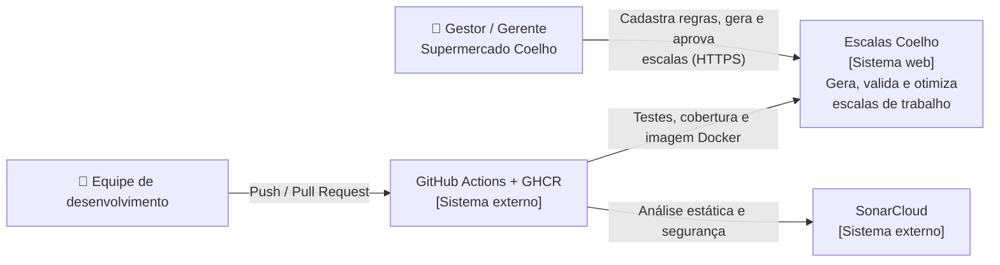
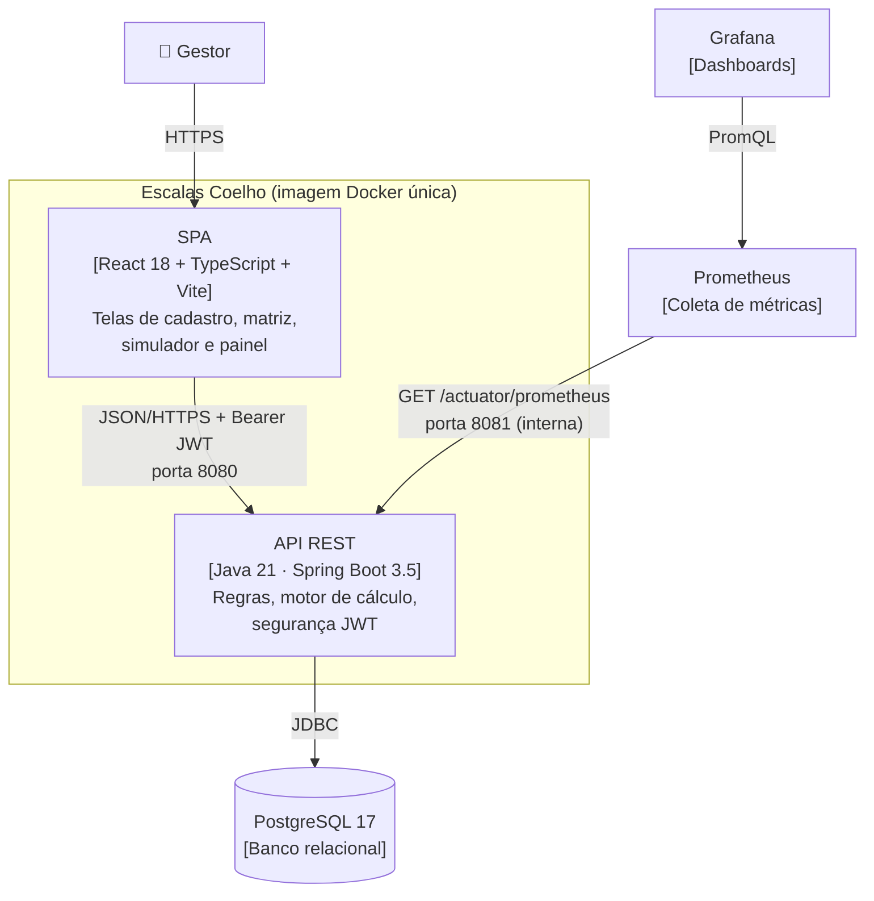
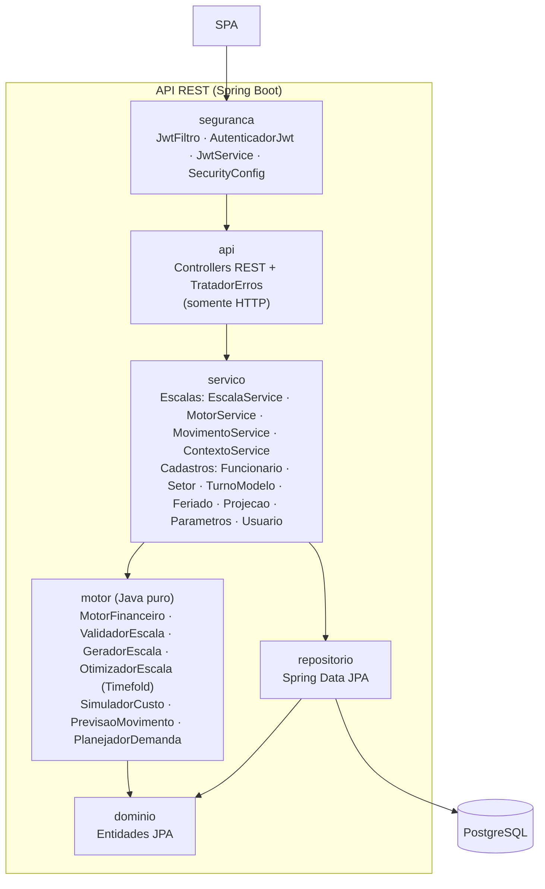
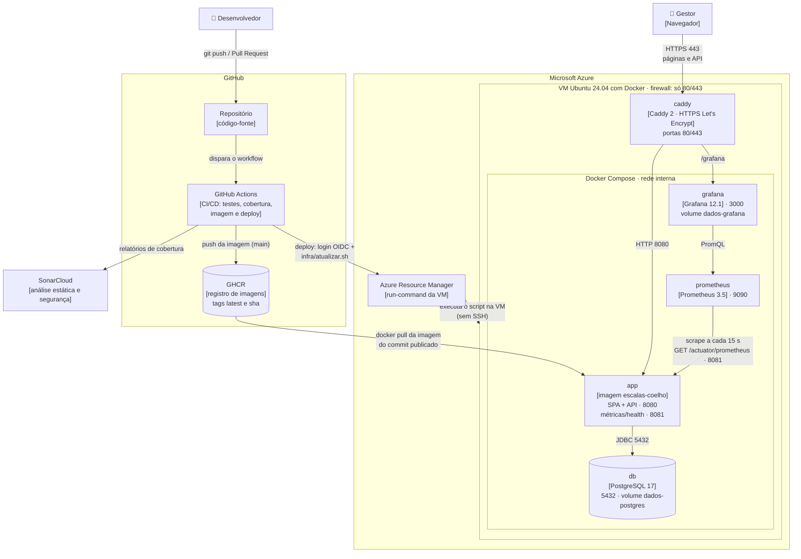

# Arquitetura — modelo C4

Diagramas em Mermaid (renderizados pelo GitHub).

## Nível 1 — Contexto

## Nível 2 — Contêineres

## Nível 3 — Componentes da API

As setas mostram o único sentido permitido das dependências: **api → servico → motor / repositorio → dominio**.
Os controllers só tratam HTTP (rota, validação da entrada, código de status); regras de negócio e transações ficam nos
serviços; o motor não conhece banco nem web. Essas regras são verificadas a cada build pelo `ArquiteturaTest`
(ArchUnit), de modo que uma dependência fora do desenho quebra o pipeline.

## Implantação

Como o sistema roda em produção (detalhes e passo a passo em [deploy.md](deploy.md)). A VM é criada pelo Terraform
([`infra/terraform`](../infra/terraform/main.tf)) e os contêineres seguem o
[`docker-compose.prod.yml`](../docker-compose.prod.yml).

| Elemento | Exposição | Observação |
|----------|-----------|------------|
| Caddy (proxy reverso) | Pública (80/443) | Termina o TLS; senhas, tokens e documentos nunca trafegam em texto aberto. |
| `app` | Interna (8080 via proxy) | Uma única instância, porque o limite de tentativas de login fica em memória. Segredos vêm de `/etc/escalas/env`, gravado pelo Terraform. |
| Porta 8081 | Somente rede interna | Health check do provedor e coleta do Prometheus; nunca exposta à internet. |
| `db` | Somente rede interna | Dados persistidos no volume `dados-postgres`; pode ser trocado por um PostgreSQL gerenciado. |
| Prometheus | Somente rede interna | Coleta as métricas da aplicação a cada 15 s. |
| Grafana | Pública, com login | Em `https://<APP_HOST>/grafana`, atrás do Caddy, com senha (`GRAFANA_SENHA`). |
| SSH (22) | Fechada | Não há acesso manual: atualizações só pelo pipeline, via run-command do Azure. |

## Stack e justificativas

Todas as escolhas estão entre as preferidas (✅) do
[Portfólio Directions](https://github.com/CatolicaSC-Portfolio/The-Portfolio-Playbook/blob/main/directions/portfolio-directions-GERAL.md).
O modelo de dados está em [modelo-de-dados.md](modelo-de-dados.md).

| Tecnologia | Por que foi escolhida |
|------------|-----------------------|
| **Java 21** | Tipagem forte e `BigDecimal` para valores monetários sem erro de arredondamento; `record` deixa os DTOs e os resultados do motor imutáveis e curtos. Versão LTS. |
| **Spring Boot 3.5** | Reúne em um só projeto API REST, segurança, JPA, validação, agendamento (geração automática da escala) e métricas, com convenções que reduzem configuração. |
| **Spring Security + JWT (JJWT)** | Autenticação stateless: o token vai no cabeçalho de cada requisição, sem sessão guardada no servidor. O token só identifica o usuário; situação e perfil são conferidos no banco a cada requisição. |
| **Spring Data JPA (Hibernate)** | Repositórios com consultas parametrizadas (protege contra SQL injection) e mapeamento das entidades sem SQL manual para o CRUD. |
| **PostgreSQL 17** | Banco relacional robusto e gratuito, com integridade referencial e restrições únicas que protegem as regras (ex.: um feriado por data). Usado também nos testes, para que eles rodem no mesmo banco da produção. |
| **React 18 + TypeScript** | A matriz colaborador × dia é uma tela muito interativa (validação a cada clique); componentes React e tipos compartilhados com a API evitam erros de contrato em tempo de compilação. |
| **Vite** | Build rápido e servidor de desenvolvimento com proxy para a API. |
| **Timefold Solver** | Biblioteca Java de otimização com restrições (Apache 2.0), feita para problemas de escala de pessoal. As regras viram *constraint streams* testáveis, e o motor continua Java puro. |
| **JUnit 5, AssertJ, MockMvc e JaCoCo** | Testes unitários do motor e de integração da API inteira contra o PostgreSQL; o JaCoCo bloqueia o build abaixo de 75%. |
| **ArchUnit** | Transforma o desenho em camadas em teste automatizado: o build falha se um controller acessar um repositório ou se o motor depender do banco. |
| **Vitest + Testing Library** | Mesma configuração do Vite; testa as telas como o usuário as usa (por papel, rótulo e texto). |
| **ESLint (typescript-eslint)** | Análise estática do frontend no pipeline (regras de TypeScript e de React Hooks), sem nenhum aviso tolerado. |
| **Docker e Docker Compose** | Uma imagem com SPA + API e o mesmo conjunto de contêineres em desenvolvimento e produção. |
| **GitHub Actions** | Pipeline junto do código: testes, cobertura, SonarCloud, imagem e deploy, sem servidor de CI próprio. |
| **SonarCloud** | Análise estática e de segurança gratuita para repositório público, com os relatórios de cobertura dos dois lados. |
| **Prometheus + Grafana** | Monitoramento open source; o Spring Actuator expõe as métricas no formato do Prometheus sem código extra. |
| **Azure + Terraform** | VM com controle total do ambiente (não é PaaS que esconda a infraestrutura) e infraestrutura reproduzível como código; crédito estudantil sem cartão. |
| **Caddy** | Proxy reverso com HTTPS automático, sem configuração extra. |

## Decisões

| Decisão | Motivo |
|---------|--------|
| Arquitetura em camadas, com o **motor isolado** do Spring e do banco | O núcleo de custo e de regras trabalhistas é testado com cenários em memória (`motor/*Test`), sem infraestrutura. O sentido das dependências é verificado pelo `ArquiteturaTest`. |
| **SPA + API na mesma imagem** | Um único artefato para implantar e versionar; o Spring serve o build do Vite e encaminha as rotas da SPA (`SpaController`). |
| **JWT stateless**, com o usuário conferido a cada requisição | Escala horizontal sem sessão no servidor; segredo fornecido pelo ambiente (`APP_JWT_SECRET`). Como situação e perfil vêm do banco (`AutenticadorJwt`), desativar uma conta ou mudar o perfil vale na hora, sem esperar o token expirar. |
| **PostgreSQL** em todos os ambientes, inclusive nos testes de integração | Mesmo dialeto em testes e produção; atende à exigência de persistência real. |
| **Porta de gerência separada (8081)** | Métricas e health check ficam fora da porta pública. |
| **Dois geradores: guloso (rápido) e otimizado (Timefold Solver)** | O guloso preenche dia a dia, com quem tem menos horas, em milissegundos — é o usado na geração automática diária. O otimizador modela cada pessoa necessária como uma *vaga* e busca a melhor atribuição da semana inteira (heurística de construção + busca local, com tempo limite), com pontuação em três níveis: hard = CLT (nunca violada), medium = vagas sem ninguém, soft = custo e equilíbrio de horas. As vagas vêm do mesmo planejador de demanda, então os dois geram para a mesma demanda e podem ser comparados. |
| **Otimização síncrona, com tempo e simultaneidade limitados** | Gerar com o Timefold e comparar os algoritmos respondem na mesma requisição: o solver para em no máximo `APP_OTIMIZACAO_SEGUNDOS` (5 s), ou antes, quando passa um quarto desse tempo sem melhorar, e a tela mostra o andamento enquanto isso. Para que vários pedidos ao mesmo tempo não ocupem o servidor, no máximo `APP_OTIMIZACAO_SIMULTANEAS` (2) rodam juntos (`LimiteOtimizacoes`); os demais recebem HTTP 429 na hora, com `Retry-After`. Uma fila assíncrona (disparar, acompanhar e buscar o resultado) só se justificaria com tempos bem maiores ou muitos usuários simultâneos. |
| **Previsão explicável (estatística), não um modelo opaco** | Média ponderada recente do mesmo dia da semana + efeitos medidos no próprio histórico (início do mês, véspera de feriado), com a justificativa de cada número. Funciona com poucas semanas de dados, é testável com cenários exatos e o gestor entende e confia na previsão; sem histórico, vale a configuração manual. |
| **Demanda por faixa com escolha gulosa de turnos** | Pessoas por faixa = ⌈clientes ÷ (capacidade × horas)⌉; a cada passo, o modelo de turno que cobre mais faixas descobertas. Simples de explicar e próximo do ótimo para os poucos modelos de turno de uma loja. Abaixo do previsto é alerta (o gestor decide); abaixo do piso manual é erro. |
| **VM no Azure com Docker Compose**, provisionada com **Terraform** | Mantém o controle da arquitetura exigido pela linha Web Apps (sem PaaS que esconda a infraestrutura) e roda a mesma composição do desenvolvimento, com monitoramento junto. A infraestrutura é reproduzível e revisável em PR. |
| **Deploy por run-command com login OIDC**, sem SSH | O pipeline não guarda senha nem chave: o Azure confia só em jobs do ambiente `producao` deste repositório, e a permissão vale apenas para a VM. Cada deploy é um commit; o rollback é reimplantar um commit anterior. |
| **Caddy como proxy reverso** | HTTPS com certificado renovado automaticamente; o Grafana fica no mesmo domínio, em `/grafana`. |
