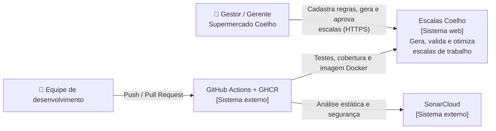
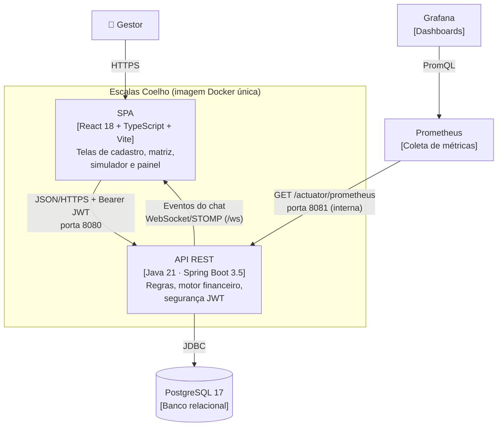
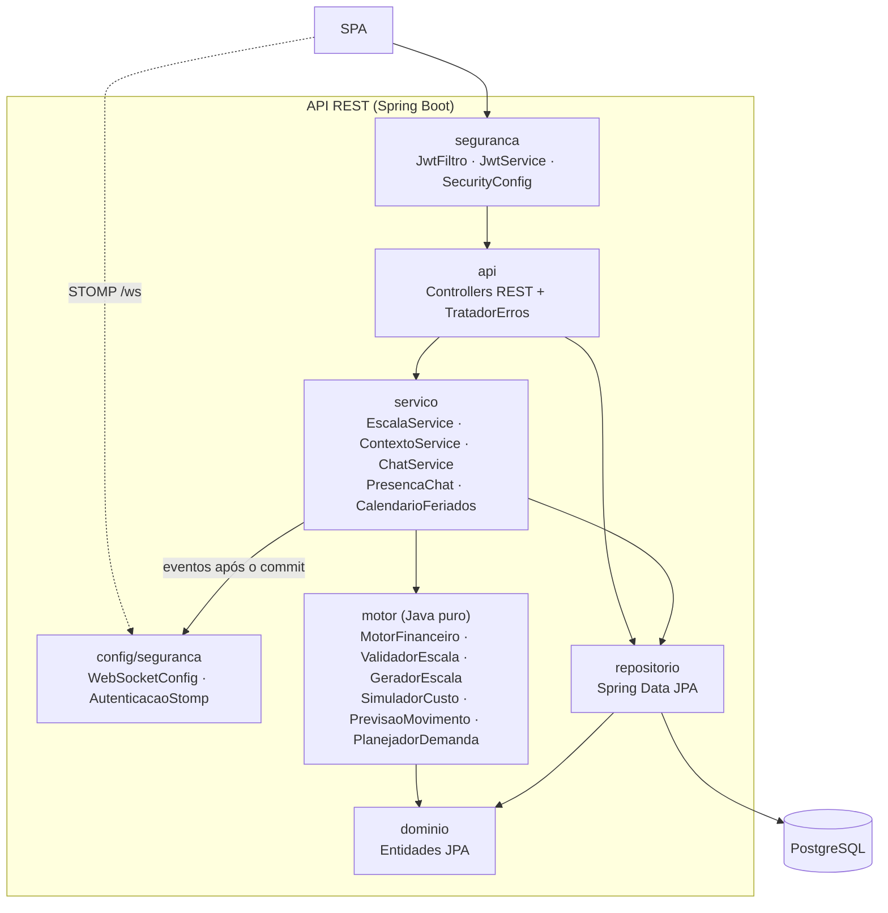
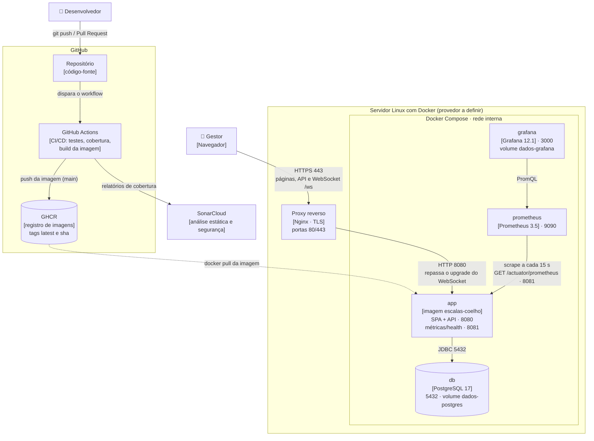

# Arquitetura — modelo C4

Diagramas em Mermaid (renderizados pelo GitHub).

## Nível 1 — Contexto

## Nível 2 — Contêineres

## Nível 3 — Componentes da API

## Implantação

Como o sistema roda em produção (detalhes e variáveis em [deploy.md](deploy.md)). Os contêineres e as portas
seguem o [`docker-compose.yml`](../docker-compose.yml); itens tracejados são opcionais ou dependem do provedor de
hospedagem, ainda a definir.

| Elemento | Exposição | Observação |
|----------|-----------|------------|
| Proxy reverso | Pública (80/443) | Termina o TLS; senhas, tokens e mensagens do chat nunca trafegam em texto aberto. |
| `app` | Interna (8080 via proxy) | Uma única instância, porque o broker do chat é em memória. Segredos vêm do ambiente (`.env` / provedor). |
| Porta 8081 | Somente rede interna | Health check do provedor e coleta do Prometheus; nunca exposta à internet. |
| `db` | Somente rede interna | Dados persistidos no volume `dados-postgres`; pode ser trocado por um PostgreSQL gerenciado. |
| Prometheus / Grafana | Restrita | O compose publica 9090 e 3000; em produção, restringir por firewall ou publicar só o Grafana atrás do proxy, com senha (`GRAFANA_SENHA`). |

## Decisões

| Decisão | Motivo |
|---------|--------|
| Arquitetura em camadas, com o **motor isolado** do Spring e do banco | O núcleo financeiro e trabalhista é testado com cenários em memória (`motor/*Test`), sem infraestrutura. |
| **SPA + API na mesma imagem** | Um único artefato para implantar e versionar; o Spring serve o build do Vite e encaminha as rotas da SPA (`SpaController`). |
| **JWT stateless** | Escala horizontal sem sessão no servidor; segredo fornecido pelo ambiente (`APP_JWT_SECRET`). |
| **PostgreSQL** em todos os ambientes, inclusive nos testes de integração | Mesmo dialeto em testes e produção; atende à exigência de persistência real. |
| **Porta de gerência separada (8081)** | Métricas e health check ficam fora da porta pública. |
| **Previsão explicável (estatística), não um modelo opaco** | Média ponderada recente do mesmo dia da semana + efeitos medidos no próprio histórico (início do mês, véspera de feriado), com a justificativa de cada número. Funciona com poucas semanas de dados, é testável com cenários exatos e o gestor entende e confia na previsão; sem histórico, vale a configuração manual. |
| **Demanda por faixa com escolha gulosa de turnos** | Pessoas por faixa = ⌈clientes ÷ (capacidade × horas)⌉; a cada passo, o modelo de turno que cobre mais faixas descobertas. Simples de explicar e próximo do ótimo para os poucos modelos de turno de uma loja. Abaixo do previsto é alerta (o gestor decide); abaixo do piso manual é erro. |
| **Chat: envio por REST, entrega por WebSocket** | As mensagens passam pela mesma validação, autorização e testes da API; o WebSocket (STOMP) só entrega eventos, e apenas após o commit. O broker é em memória: para mais de uma instância da aplicação, trocar por um broker externo (ex.: RabbitMQ). |
