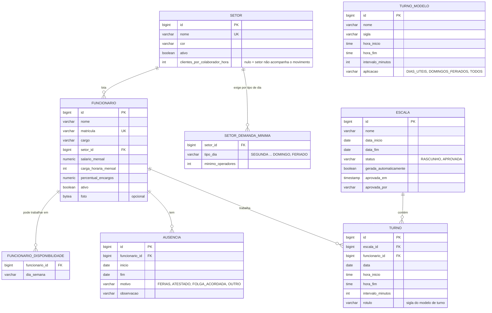
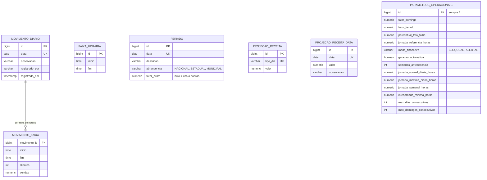
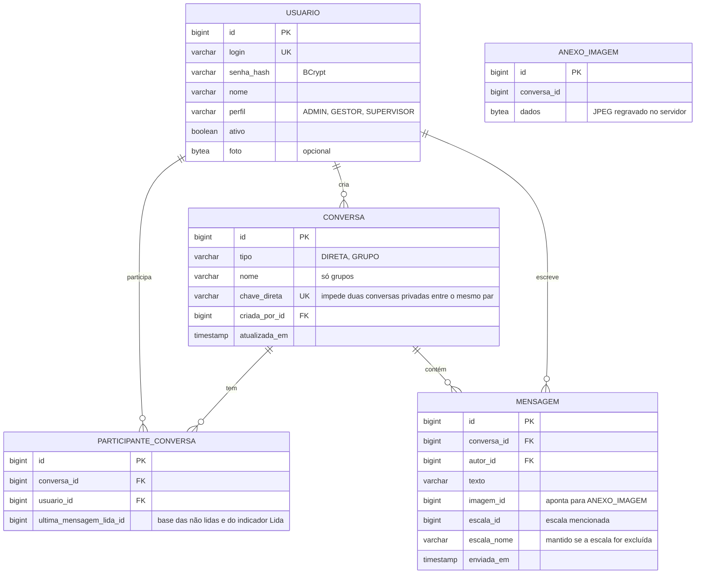

# Modelo de dados

Banco relacional **PostgreSQL**. As tabelas são geradas pelo Hibernate a partir das entidades JPA em
[`backend/.../dominio`](../backend/src/main/java/br/com/coelho/escalas/dominio/Funcionario.java)
(`spring.jpa.hibernate.ddl-auto=update`). Os nomes abaixo são os das tabelas e colunas no banco.

## Escalas e cadastros

`TURNO_MODELO` não tem chave estrangeira para `TURNO`: ao escolher um modelo na matriz, os horários dele são
**copiados** para o turno. Assim, alterar um modelo depois não muda escalas já montadas.

## Previsão, custo e parâmetros

- **Receita projetada de um dia:** `PROJECAO_RECEITA_DATA` da data, se existir; senão, `PROJECAO_RECEITA` do tipo de dia.
- **Faixas horárias:** `FAIXA_HORARIA` define as faixas em que o fechamento do dia é lançado (`MOVIMENTO_FAIXA`).
- **Parâmetros:** registro único (`id = 1`) com as regras da CLT e os limites de custo usados pelo motor.

## Usuários e chat

- `PARTICIPANTE_CONVERSA` tem restrição única em `(conversa_id, usuario_id)`.
- `MENSAGEM` tem índice em `(conversa_id, id)`, usado na paginação do histórico.
- Os bytes das imagens ficam em `ANEXO_IMAGEM`, fora de `MENSAGEM`, para o histórico carregar sem eles.
- `escala_id` não é chave estrangeira de propósito: a mensagem continua legível (pelo `escala_nome`) mesmo se a
  escala for excluída.
